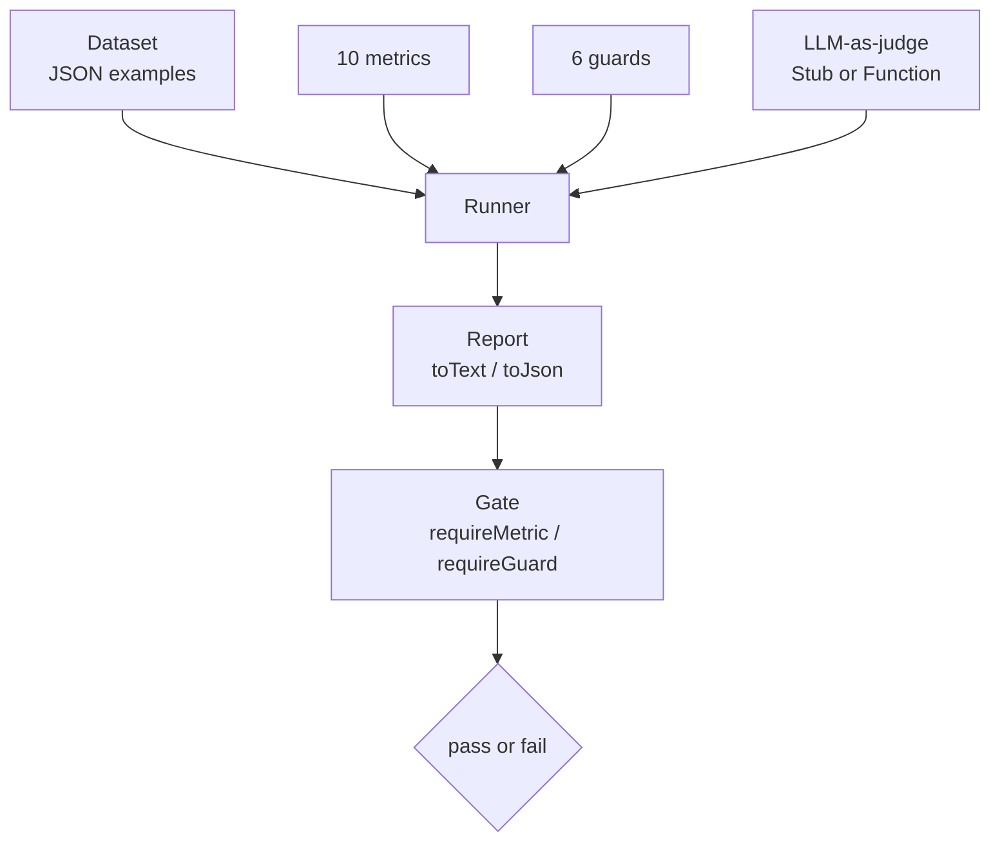

<p align="center">
  <em>Score answers, block unsafe output, and turn quality into a binary release decision — offline, standard library only.</em>
</p>

<p align="center">
  
  
  
</p>

---

Ten metrics, six guardrails and an LLM-as-judge abstraction, wired into a runner
that produces either a human-readable report or machine JSON. No model download, no
network, no dependencies.

## Quick start

```java
List<Example> data = List.of(
    new Example("q1", "Capital of France?", "Paris", "Paris"),
    new Example("q2", "What is 2 + 2?", "4", "I don't know."),
    new Example("q3", "Summarise.", "contact info",
                "Reach the team at bob@example.com for details.")
);

Runner runner = new Runner()
        .withMetrics("exact_match", "f1", "rouge_l", "contains", "regex_match")
        .withGuards(Map.of("pii", Guards.defaults().get("pii")))
        .withJudge(new StubJudge());

Report report = runner.run(data);
System.out.println(report.toText());
```

Turn it into a pass/fail gate:

```java
Gate gate = new Gate().requireMetric("f1", 0.5).requireGuard("pii");
for (ScoredExample se : report.items) {
    GateResult gr = gate.evaluate(se);
    System.out.println("gate[" + se.example().id() + "]: " + (gr.passed() ? "PASS" : "FAIL"));
}
```

```bash
javac -d build $(find src/main/java -name '*.java')
java -cp build bastion.examples.Demo
```

## Ten metrics

`exact_match` · `f1` · `bleu` · `rouge_l` · `cosine` · `levenshtein` · `contains` ·
`numeric_match` · `json_equal` · `regex_match`

Each is a pure function of `(prediction, reference)` — no state, no model, no
service. `cosine` runs on a hashing bag-of-words encoder built into the repo, so
there is no embedding model to download.

## Six guardrails

| Guard | Blocks |
|---|---|
| `PiiGuard` | email, mobile, card, ID patterns |
| `ToxicityGuard` | wordlist match |
| `RegexAllowGuard` / `RegexDenyGuard` | allow or deny by pattern |
| `LengthBoundGuard` | too short / too long |
| `JsonFieldGuard` | missing or wrongly typed JSON fields |
| `CompositeGuard` | `allOf` / `anyOf` combinations |

Guards are screening, not classification: they run offline against patterns and a
wordlist. A guard that passes does not mean the text is safe — it means it matched
nothing on the list.

## How the pieces fit



`StubJudge` is deterministic, so tests do not call a model. `FunctionJudge` adapts
your real model when you want one.

## Install

Plain Java 21 source — copy `src/main/java/bastion` into your module. Nothing else
on the classpath.

## Tests

```bash
java -jar junit-platform-console-standalone-1.10.2.jar --class-path build --scan-class-path
```

57 JUnit 5 cases, no network, no fixtures.

## Limitations

- **Lexical metrics are lexical.** BLEU/ROUGE reward n-gram overlap, not meaning. A
  correct paraphrase in different words scores low. Treat them as one signal, not a
  verdict.
- **The "semantic" metric is a hashing bag-of-words.** It catches vocabulary overlap;
  it does not understand negation. "The drug is safe" and "the drug is not safe"
  score as nearly identical.
- **Guardrails are pattern-based.** A wordlist guard misses anything phrased
  differently. It is a cheap first pass, not a safety boundary.
- **No published benchmark numbers.** The repo ships no accuracy figures against a
  labelled set, and this README does not invent any.

## License

MIT
